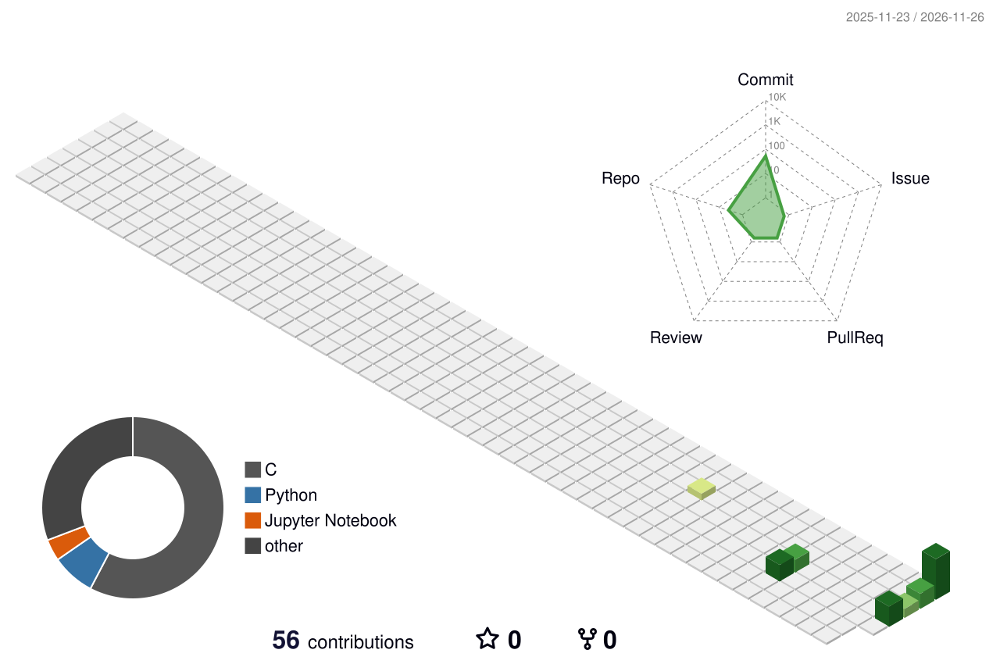

# Hi, I'm Suryansh 👋

### Computer Science Undergraduate | AI/ML Enthusiast | Problem Solver

Building with code, exploring AI, and solving problems one step at a time.

---

## 👨‍💻 About Me

- 🎓 Pursuing a **B.Tech in Computer Science and Engineering**, with an interest in software development and emerging technologies.
- 🤖 Exploring **Artificial Intelligence, Machine Learning, and Agentic AI**, particularly multi-agent systems and LLM-based workflows.
- 🔬 Working on **Deep Learning and Computer Vision**, exploring hybrid CNN–Vision Transformer architectures for medical image classification.
- 💻 Practising **Data Structures and Algorithms** through LeetCode and preparing for competitive programming challenges.
- ⚡ Outside programming, I enjoy F1, cricket analytics, and gaming.

---

## 🛠️ Tech Stack

### Programming Languages

### AI, Machine Learning & Deep Learning

### Tools & Platforms

---

## 🚀 Featured Projects

### 🩺 Hybrid CNN–ViT Model for Head and Neck Tumor Detection

**Tech:** Python | Deep Learning | Computer Vision | PyTorch

- Exploring a hybrid architecture combining CNN-based local feature extraction with Vision Transformer attention mechanisms.
- Focused on identifying and classifying head and neck tumors using endoscopic medical images.
- Investigating preprocessing, image augmentation, and model performance to improve classification accuracy.

### 🤖 Multi-Agent AI Workflow

**Tech:** Python | LangGraph | CrewAI | LLMs

- Exploring multi-agent architectures for automated task execution and structured reasoning.
- Working with generator, validator, and orchestration-based workflows.
- Investigating agent coordination and LLM-powered automation.

### 💻 LeetCode Solutions

**Tech:** C | C++ | Python

- Maintaining a collection of solutions to LeetCode problems.
- Covering arrays, strings, recursion, sorting, searching, trees, graphs, and dynamic programming.
- Focusing on optimized approaches, problem-solving patterns, and time and space complexity.

🔗 **[View Repository](https://github.com/Kumar-Suryansh/Leetcode-Solutions)**

---

## 🏙️ Contribution City

*A year of commits, built as a city.*

Every building represents a day. Taller buildings mean more contributions.

---

## 🧩 LeetCode Activity

---

### 💡 Always Learning. Always Building.

*Interested in technology, solving problems, and turning ideas into working solutions.*

