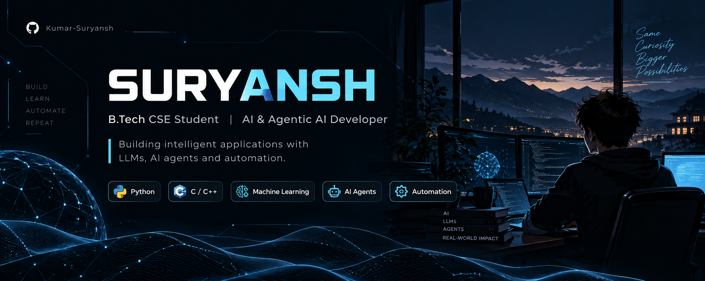

  

<h1 align="center">Hey, I'm Suryansh 👋</h1>

  <b>B.Tech CSE Student | AI & Agentic AI Developer</b>

  Building intelligent applications with Machine Learning, Large Language Models, and AI-powered automation.

  
  

---

## 👨‍💻 About Me

- 🤖 Currently working on **Agentic AI applications and AI-powered automation**.
- 🌱 Learning about **LLMs, AI agents, and agent frameworks**.
- 🤝 Open to collaborating on **Generative AI, Agentic AI, and open-source projects**.
- 💡 Interested in building practical AI systems that can reason, use tools, and automate real-world tasks.
- 💬 Ask me about **Python, C/C++, Data Structures & Algorithms, Machine Learning, and AI**.

---

## 🛠️ Tech Stack

### Programming Languages

  
  
  

### Databases

  
  

### Libraries & Development Tools

  
  
  

---

## 📊 GitHub Analytics

  
  

  

---

  <i>Build. Learn. Automate. Repeat. 🚀</i>

